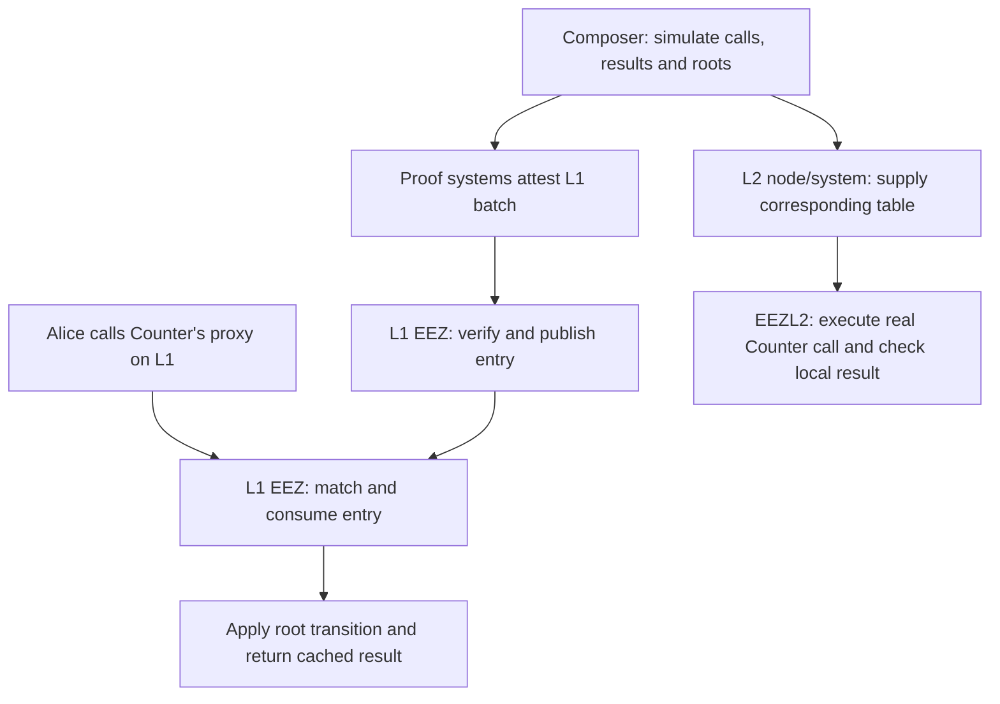

# EEZ walkthrough

Start here to understand how EEZ connects calls across Ethereum and participating
rollups. This guide follows a call through preparation, proof verification and local
execution, then explains tables, hashes, rollback, ETH accounting and system authority.

It describes the protocol contracts and their reference Rollup and proof-system
implementations. The composer, proving circuits and L2 node supply the surrounding
integration described in [Integration Boundaries](INTEGRATION_BOUNDARIES.md).
The contracts under `src/periphery/` are test fixtures, not production components.

## 1. What EEZ does

EEZ provides the contract machinery for synchronous composability between Ethereum and participating rollups, with based rollups sharing L1 sequencing as the intended setting. An application can call a remote contract through a local proxy and receive its predicted return value during its own transaction. This allows flows such as calling back into L1 while an L1-to-L2 operation is still open, or borrowing, using funds across chains, and repaying within a composed operation.

The mechanism combines **precomputation, proof verification, and local execution**:

1. A composer simulates the cross-chain operation and builds an execution table for each chain. Tables describe calls, expected results, nesting, and rollback.
2. Proof systems attest the L1 batch, including the rollup state transitions and execution tables.
3. L1's `EEZ` verifies those proofs. As entries are consumed, it executes the calls belonging on L1 and checks their observed results.
4. Each L2's `EEZL2` executes tables supplied by its trusted node/system integration. It checks local execution against those tables, without verifying proofs itself.

A proxy call therefore resolves locally using prepared data. The two chains do not share an EVM call stack. Cross-chain consistency depends on the proofs and node integration connecting the local executions correctly. Solidity rollback supplies atomicity within an execution frame; it does not independently guarantee delivery of every posted entry across chains.

For the formal model, see [Core Protocol Specification](CORE_PROTOCOL_SPEC.md). External obligations are collected in [Integration Boundaries](INTEGRATION_BOUNDARIES.md).

## 2. Basic terms and execution paths

The main actors are the composer, the proof systems, the two execution managers
(EEZ on L1 and EEZL2 on each rollup), and the applications calling through proxies.
A **cross-chain proxy** is a local contract representing an address on another chain.
Calling it lets the local manager resolve the prepared remote call.

L1 has protocol rollup ID `0`; registered rollups have nonzero IDs. These registry IDs
are separate from EVM chain IDs.

| Term | Meaning |
| --- | --- |
| Root | A stored commitment to a rollup's state. |
| Entry | The prepared data for one local execution context: calls, expected results and checks. |
| Table | A collection of entries or nested-call rows used to resolve calls. |
| Batch | A group of entries and the inputs needed to verify their proofs on L1. |
| Frame | One call context, which can contain nested calls. |
| Cursor | The position from which a table search resumes; it is not a count of successful calls. |
| Rolling hash | A digest built from observed calls and results, compared with the entry's expected digest. |

L1 entries have three execution paths. **Immediate** entries belong to the prefix
selected for execution during posting. Leading L2 transaction entries in that prefix
run automatically; the rest are available to the posting contract through a
**meta hook**, a callback in which it can make application calls that consume them.
**Deferred** entries go into per-rollup queues for consumption later in the same L1
block. Section 6 follows those paths in detail.

## 3. A first walkthrough: L1 calls an L2 counter

Suppose Alice calls `Counter.increment()` on L2 through Counter's proxy on L1. Assume zero ETH, no callbacks, and a successful predicted return value of `1`.

**Preparation.** The composer predicts Counter's result and the L2 transition from root S0 to S1. The L1 entry contains the call identity, that root transition, cached return data `abi.encode(1)`, and an expected rolling hash. The entry has no local application calls to execute on L1. Proofs attest the entry.

**L1 posting.** The account or contract submitting the batch—the poster—calls `postAndVerifyBatch`. For this example the entry is deferred into the destination rollup's queue.

**L1 consumption.** In the same L1 block, Alice calls Counter's proxy. EEZ reconstructs the call identity and scans for an entry matching that identity, destination rollup, and live S0 root. It runs the entry, applies S1, checks the rolling hash and ETH accounting, and returns the cached `1` to Alice.

**L2 execution.** The node supplies the corresponding table through the system-only
`executeIncomingCrossChainCall`. EEZL2 executes the real Counter call through Alice's
proxy on L2 and checks its local rolling hash. Each chain executes its own part of
the operation.



The diagram separates the two local paths; their scheduling and causal association belong to the integration. The L1 proof must establish the truth of the predicted remote result. L2's internal hash check alone establishes only consistency with the supplied table.

For callbacks, extend the example to Alice → L2 Counter → L1 C. The L1 entry now includes the real call to C in `l2ToL1Calls`. During L2 execution, Counter's outward call to C resolves from `expectedOutgoingCalls`. Each side executes its local application code and uses prepared results for the remote portions.

See [Execution Entry flow patterns](EXECUTION_ENTRY_SPEC.md#flow-patterns) for the paired table layouts.

## 4. How proxies connect local and remote calls

A `CrossChainProxy` represents one `(originalAddress, originalRollupId)` pair on
its local manager. Anyone can ask the manager to create one. Creation records that
identity; it does not verify the remote contract's code or grant arbitrary authority.

There are two uses of the same proxy mechanism:

- **Calling outward:** an L1 application calls the local proxy representing contract B on L2. The proxy forwards the application's caller identity, calldata, and value to L1's EEZ.
- **Executing inward:** when EEZ executes a call from remote contract B into local contract C, it invokes C through B's local proxy. C sees `msg.sender = B's proxy`.

Applications authenticate a remote caller through the proxy derived by the expected local manager for that caller's address and rollup ID. The remote address alone is insufficient. Same-network proxies are forbidden.

The proxy dispatches `executeOnBehalf` directly only for its manager. Other callers, including callers with a colliding function selector, take the cross-chain path. Return bytes are unwrapped; revert bytes are forwarded.

## 5. What an execution entry contains

The counter example needs an entry on each side. The fields below describe what
each manager executes locally and what it returns for the remote part.

| Concept | L1 field | L2 field |
| --- | --- | --- |
| Trigger identity | `proxyEntryHash` | `proxyEntryHash` |
| Calls executed locally | `l2ToL1Calls` | `incomingCalls` |
| Expected nested outward calls | `expectedL1ToL2Calls` | `expectedOutgoingCalls` |
| Expected execution digest | `rollingHash` | `rollingHash` |
| Result presented to caller | `success`, `returnData` | `success`, `returnData` |
| Root and ETH transitions | `rollupUpdates` | Absent |
| Queue routing | `destinationRollupId` | Absent |

L2 names are relative to the executing chain because its counterparty may be L1 or another L2. The L1 and L2 structs are separate ABI types.

Each frame owns its own ordered local call array. One shared expected-call table serves all nested frames within an entry. A nested row is found using:

```text
positionKey = keccak256(abi.encodePacked(crossChainCallHash, liveRollingHash))
```

The key combines the request with the current rolling hash. A forward cursor constrains which rows remain visible; children must appear after their parents. Static reads do not advance that cursor. An enclosing revert restores hash and cursor changes, so the same key can occur again; it is not a unique historical call number.

**L2-originated work has a special L1 representation.** An L1 entry with `proxyEntryHash == 0` represents L2 transaction work, including any calls it makes to L1. It must have `success == true` and empty return data. It runs in the immediate prefix or through L1's `executeL2Txs(rollupId)`. EEZL2 has no such entry point.

One L2 user transaction can produce several L2 proxy consumptions while being represented by one L1 L2Tx entry. Conversely, several completed top-level L1-to-L2 calls can require separate L2 deliveries. Nested activity stays inside its open frame. See the [E2E frame-coherence guide](../script/e2e/BUILD_AND_REVIEW_E2E_TESTS.md#the-frame-coherence-invariant).

### Loading and consuming on L2

`executeIncomingCrossChainCall` loads its table and sets `lastLoadBlock` itself; it
does not require an earlier same-block load. Entry zero's identity must match its
first incoming call. After successful execution, `entryIndex` becomes 1, so later
proxy calls can consume the remaining entries in that block. A failed delivery
reverts the load and restores the previous table and cursor.

## 6. The batch lifecycle and proof boundary

### Registration and posting

Before participation, a rollup deploys its policy contract and registers it with EEZ. EEZ allocates an ID, stores the initial root and a zero ETH ledger balance, then calls the manager's registration callback with the original registrant. The reference Rollup requires that registrant to be its owner and permits registration once.

`postAndVerifyBatch` then follows this sequence:

1. Check optional live-root assertions and structural constraints: ordering, registration, proof-system indices, entry membership, and prefix bounds.
2. Ask each rollup manager to approve its selected proof-system subset and return its verification keys. The reference manager enforces its threshold and membership here.
3. Verify one proof per listed proof system. Every proof must pass; a false result or verifier revert aborts the post.
4. Mark participating rollups verified in the current block and replace their previous queues and cursors.
5. Attempt the leading zero-hash L2Tx entries directly from calldata.
6. Load any remaining immediate entries and invoke the poster's `executeMetaCrossChainTransactions()` hook to consume them.
7. Publish the deferred remainder to per-rollup queues, discard immediate leftovers, and clear the temporary tables.

### Immediate work, deferred queues and settlement order

The hook is an external callback to the posting contract. While its immediate table is active, top-level mutable consumption and top-level static lookups use only this batch's temporary tables. They cannot fall back to persistent queues, even for a rollup verified by an earlier batch in the same block. Mutable entries share one global cursor across rollups during the hook; nested calls use the active entry's expected-call table. Unconsumed immediate entries are deleted rather than queued. Deferred entries are published after the hook and are available later in the same block.

**Proof acceptance and entry execution are separate.** Posting a deferred entry does not apply its root transition. Consumption forward-scans for the first complete match; committing a later match passes over earlier candidates. A matching entry that reverts restores the cursor and may be retried, subject to the mutable retry limit in §8. Every accepted re-verification replaces participating queues, even within the same block.

**Settlement order is determined on L1.** Deferred entries in different rollup queues can execute in either order when their checks pass; their positions in the proven batch array do not impose an order across queues. `executeL2Txs` and application calls through proxies are permissionless, although each call must still match its identity, roots, and other execution checks. Applications must enforce dependencies on other entries or L1 state at execution time. See the [settlement model](CORE_PROTOCOL_SPEC.md#settlement-model).

Immediate failures have special handling: a caught nonempty revert can be skipped; empty revert data aborts; a nonempty leading run with no successes aborts the whole post. A later outer revert unwinds prior successes and logs in that posting transaction. The meta hook may leave entries unused, so posting does not guarantee complete delivery.

### What the proof commits to

The shared proof commitment covers full mutable/static entries, selected blob hashes, the hash of the batch's `callData` field, rollup-keyed custom data, and an optional bound sender. Each verifier additionally receives a digest of the rollup IDs and verification keys assigned to it. The exact encodings are in [Multi-Prover Specification](MULTI_PROVER_SPEC.md#per-ps-publicinputshash-two-stage).

The two immediate-prefix counts and batch-level root assertions are **outside the proof commitment**. Sender binding can restrict who posts, while the intended poster's policy must enforce the desired dispatch. Solidity still bounds both counts and rejects:

- A zero-hash L2Tx entry immediately after the immediate prefix (`ImmediateCountStrandsLeadingL2Tx`), including a boundary after proxy entries.
- A codeless poster when remaining immediate entries require the meta hook (`MetaEntriesWithoutReceiver`).
- Immediate static entries when no meta hook will run (`ImmediateStaticEntriesWithoutImmediateEntries`).

Every listed proof system is verified, even one selected by no rollup, whose rollup/key accumulator remains zero. Setting the reference manager's threshold to zero does not permit proof-free posting: EEZ still requires a nonempty proof-system subset for every participating rollup.

### Verification context and replay

The reference manager's `getCustomData` supports no context, a specific available historical block hash, or current timestamp plus previous block hash. This is distinct from the same-block consumption gate. Explicit chain ID, EEZ address, and protocol version are absent from the proof domain; deployment separation and freshness are external responsibilities.

**Reposting and execution replay are distinct.** There is no consumed-proof nonce. A proof may be posted again while its verification policy, context, blob inputs, and any supplied root assertions remain valid. Same-block consumption gates do not make it single-use. Replay prevention across queue generations relies on rollup/prover rules: every successfully committed entry must advance at least one pinned root, and root management must not restore old roots. Solidity checks current-root equality but does not enforce those history rules. Restoring old roots can make old entries eligible again if the other checks pass. Even when stale entries cannot execute, an accepted repost still replaces queues and activates the same-block root-escape lock. See [Core §H.3](CORE_PROTOCOL_SPEC.md#h3-forward-scan-consumption) and [Caveats](CAVEATS.md).

## 7. How execution is checked

On L1, `_executeEntry` first checks every `currentRoot` and establishes the entry's allowed rollup set. It seeds the rolling hash, executes the local calls, then applies the new roots and ETH deltas. Final checks must pass for those writes to survive. Consequently, callbacks observe pre-entry roots; nested rows do not independently advance roots.

### Call identities and rolling hashes

The rolling hash is a chained digest of execution observations. L1 seeds it with ordered starting roots and the entry identity. L2 seeds it with the entry identity alone. The shared tags identify call start/result, nested start/end, a missing nested call, and insufficient dispatch gas.

The distinction between commitments matters:

- The **full entry hash** binds supplied fields into the proof.
- The **call hash** identifies a request.
- The **rolling hash** compares the local execution observations with the expected trace.

These hashes have different purposes. In particular, source and destination rolling hashes generally differ. The rolling hash records observed call identities, outcomes, and nesting; it does not commit to every L1 storage write. Different L1 state effects can produce the same recorded results, and separate entries have no shared rolling hash enforcing their relative order.

| Call-hash site | Gas value included in identity |
| --- | --- |
| All L1 sites | Zero |
| Local delivered-call folds on L2 | Zero |
| L2 incoming entry binding | First incoming call's supplied `gas` |
| Outgoing mutable/static calls from L2 | Observed `gasleft()` if `USE_GAS_LEFT`; otherwise zero |

Thus even the same logical cross-chain call can have different identity hashes at different sites. Gas limits still affect actual dispatch. The preflight check is an estimate and excludes some costs; zero gas cap bypasses that check and forwards available gas subject to EVM rules.

### Execution failures and destination checks

Valid proofs must exclude `CALL_NOT_FOUND` and `CALL_INSUFFICIENT_GAS` from expected hashes. Solidity cannot inspect an expected digest to enforce that policy. A surviving marker should cause a mismatch against an honest expectation, but ordinary enclosing reverts erase transient observations. Hash equality is not a standalone proof of remote truth or full delivery.

Both managers reject a local callback targeting the executing manager's own address with `EEZDestinationForbidden`, including static callbacks. This check compares against the runtime manager address, which is the manager proxy address under delegatecall.

See [Core hash matrix](CORE_PROTOCOL_SPEC.md#c-action-hash-computation), [rolling hashes](CORE_PROTOCOL_SPEC.md#e-rolling-hash), and [Integration Boundaries](INTEGRATION_BOUNDARIES.md).

## 8. Reads and reverts

A call can fail while its caller continues. The important distinction is which
frame reverts and which observations survive.

### Reverts and rollback spans

| Situation | Behavior |
| --- | --- |
| Local target naturally reverts | The processor records failure and revert bytes. The entry may still commit if that is the expected outcome. |
| Top-level mutable entry has `success == false` | Execute and validate, then revert with cached data, undoing entry effects and cursor movement. |
| Nested outward call has `success == false` | Execute its local callbacks, check its sub-hash, then revert the nested frame. |
| A successful call's effects must later be undone | `revertNextNCalls` executes a contiguous span in a self-call that deliberately reverts. |
| Cross-chain static read | Resolve a static entry/row and check any local read-only callbacks; do not advance a cursor. |

The deliberate span uses `ContextResult(rollingHash, reentrantConsumed)` to carry bookkeeping out through revert data. The parent restores those two values while storage changes, ETH transfers, and interior logs stay rolled back. An ordinary revert has no such transport.

The table describes paths that reach their final checks. A nested execution can instead fail earlier with a runtime validation error, or fail its sub-hash check. An application can catch that revert, and the outer entry can still commit if its surviving observations match. Outer success does not establish completion of every erased nested frame. See [intermediate-revert tests](../test/EEZIntermediateRevert.t.sol) and the [builder/prover responsibilities](INTEGRATION_BOUNDARIES.md#builder-and-prover).

A missing nested mutable row has a specific application-visible outcome: `_consumeNestedCall` records `CALL_NOT_FOUND` and returns success with empty bytes. An enclosing application frame can then revert, erasing that marker while passing the apparent success through its revert data. A caller that catches it must not treat that result as proven remote approval. Top-level mutable and static misses revert immediately. The [reverted-probe caveat](CAVEATS.md#edge-cases) describes the accepted boundary.

### Static reads

A bounded self-call that attempts `TSTORE` detects static context and routes reads to `staticCrossChainCall`. The proxy reads `STATIC_CHECK_GAS` from its manager on each cross-chain routing call; the current cap is 1,000 and an implementation upgrade can change it.

Top-level static reads use a separate pool. L1 matches call identity, destination, and live root pins; L2 matches identity and `expectedEntryIndex == entryIndex`. Both top-level paths require tables from the current local block. Nested reads use the active entry's expected-call table. Static callbacks require predeployed proxies, zero value, static mode, and no rollback span. Their result hash is a separate untagged accumulator, starting at zero.

**Static candidate selection.** Both managers try candidates in order, skipping those whose callback-result hashes mismatch and using the first hash-valid result. This works for top-level and nested reads. For example, a remote `quote()` that calls back to a local `rate()` can return 1, then 2 after a local write, without advancing a cursor or changing the host rolling hash: the two rows have different expected callback-result hashes. A hash-valid cached revert is terminal; structural or gas-preflight errors also revert immediately rather than trying another candidate. Exhaustion reverts `ExecutionNotFound()` on L1 or `EntryNotFound(hash, callGas)` on L2. The latter supports the observed-gas [probe recipe](../test/GasProbe.t.sol).

Builders must reject or restructure conflicting answers that share the lookup context and validating callback hash, including gas-sensitive results with empty callback arrays. Trying rejected candidates also spends gas and can exhaust a budget that fits either candidate alone. See the [static-read examples](STATIC_ENTRY.md#44-local-writes-between-identical-static-reads) and [remaining call-pattern limits](CALL_PATTERN_LIMITS.md).

### Mutable retries

Mutable resolution selects the first matching row; it does not try alternatives after an execution-hash mismatch. A revert followed by a local write and an identical retry can therefore reuse an outdated row. A successful call undone by its parent can do the same. The [characterization tests](../test/EEZExpressiveness.t.sol) cover rejected retries on both chains. Mutable candidate retries are not implemented; whether to add them remains undecided.

Successful nested rows also return a saved answer without including it in the nested closing hash. After rollback, a reused row could run callbacks against new state while returning an old answer. This separate source-level concern has not been reproduced by the retry tests. See [Call-pattern limits](CALL_PATTERN_LIMITS.md#1-mutable-call-revert-local-write-identical-retry) for the examples and validation scope, and [Caveats](CAVEATS.md#delivery-and-execution-semantics) for current support limits.

## 9. ETH accounting

On L1, each successfully committed entry checks:

```text
sum(rollupUpdates.etherDelta)
    = ETH received through entry proxy calls
    - ETH paid by successful local calls
```

Reverted transfers and their accounting unwind together. Each rollup's ledger must remain nonnegative. At completed entry boundaries, protocol-accounted transfers preserve held ETH minus total rollup liabilities, with external/forced ETH treated separately.

On L2, loads add pooled funding, incoming calls spend it, and outgoing proxy value is transferred to `SYSTEM_ADDRESS`. Replacing a table retains unused ETH. Actual mint/burn semantics, residual inventory, and end-to-end conservation require node/circuit rules; Solidity performs transfers and has no per-table funding ledger.

### ETH sent before proxy deployment

At cross-chain proxy construction, prefunded ETH is swept once to `RECOVERY_ADDRESS` with a 100,000-gas cap. The sweep ignores transfer failure, leaving that ETH in the proxy; it is separate from normal entry accounting.

See [L2 funding and inventory](INTEGRATION_BOUNDARIES.md#l2-funding-and-inventory) for the node/circuit accounting responsibilities.

## 10. Trust, authority and upgrades

| Actor or boundary | Authority / assumption |
| --- | --- |
| ProxyAdmin owners: EEZ, EEZL2, and each Rollup | Can replace the corresponding implementation, including its logic and immutable configuration. These upgrade authorities are separate from operational ownership and are part of the trust model. |
| Rollup policy contract and owner | Choose accepted proof systems, keys, and threshold. The reference owner can initiate direct root replacement, subject to EEZ's active-execution and same-block lockouts; root escape does not adjust the ETH ledger. |
| ECDSA verifier owner and signer | The owner can rotate the accepted signer. The reference `DeployL1` uses one ECDSA verifier at threshold 1, so that signer supplies the proof authorization; all runtime entry checks still apply. |
| Proof systems | Must establish the correctness of remote execution, results, state transitions, and required policies. An accepting mock only tests contract mechanics. |
| Poster, meta hook, and consumers | The poster controls submission and permitted dispatch choices; the hook may omit work or revert. Permissionless consumers can advance a queue past earlier candidates by successfully consuming a later matching entry. |
| L2 `SYSTEM_ADDRESS` | Can replace tables and initiate incoming delivery. Assumed node-controlled, non-adversarial, and unreachable by application reentrancy, including on ETH receipt. |
| Composer / node | Must preserve causal ordering, correlate source and delivery occurrences, prevent invalid replay, fund execution, and reject or restructure unsupported mutable and static traces. |
| Deployment / upgrade integration | The [reference package](../deployment/README.md) already deploys upgradeable EEZ, EEZL2, and Rollup, with atomic Rollup initialization and a directly deployed ECDSA verifier. Production configuration, proof domains, artifact pinning, and storage/transient compatibility require deployment-specific review. |

### Execution guards and root authority

EEZ intentionally permits nested proxy execution. It separately blocks `postAndVerifyBatch` reentry during active execution and the meta-hook window. Verification callbacks use static calls. `registerRollup` has no corresponding execution/hook guard and may itself be called during those windows; its callback remains subject to the guards on any other function it calls. Outside those windows, a registration callback may also post an otherwise valid batch.

On L1, entry validation restricts local call sources and the routed destination to the entry's proven rollup set. Runtime checks restrict nested targets to that set. These checks limit which remote identities an entry can exercise; they do not replace application authorization. EEZL2 has no equivalent per-entry proven-rollup set. It relies on the trusted system's tables and node/prover policy, while retaining proxy authorization, lookup, and execution checks.

There is no manager-handoff API for an existing rollup ID, but a registered proxy manager can be upgraded without changing that address. Reference owner operations can change future verification policy. Direct root escape is blocked during active execution and after that rollup has been verified in the current block. Before verification, it can invalidate prepared entries' root assumptions; restoring an old root can reopen replay eligibility as described in §6. `setRoot` emits `RootUpdated` and leaves `etherBalance` unchanged. See [Multi-Prover Specification](MULTI_PROVER_SPEC.md) and [Caveats](CAVEATS.md).

### Upgrades and proxy address continuity

Cross-chain proxy addresses are deterministic through CREATE2. Proxy addresses depend on the manager address and actual creation bytecode, including compiler/metadata settings. Changing the init-code hash during an upgrade changes predicted addresses: with unchanged authorization storage, existing proxies remain authorized, while `getOrCreateCrossChainProxy` can deploy another proxy for the same remote pair at its new address. Existing balances, approvals, and application authentication therefore depend on preserving address continuity. The [upgrade scripts](../deployment/README.md#upgrades) check the init-code hash. Deployments must pin their actual artifacts and check compatibility across upgrades. Proxies also expose their own local code and balance to introspection. See [Core §B.3](CORE_PROTOCOL_SPEC.md#b3-crosschainproxysol) and [Caveats](CAVEATS.md).

The [upgrade scripts](../deployment/Upgrade.s.sol) check configured immutable values and manager proxy init-code hashes where applicable, but do not validate storage layouts. These are script checks: a ProxyAdmin owner can call `upgradeAndCall` directly without them. Review each authority, replacement implementation, migration, and address-continuity requirement; the Rollup's owner, keys, threshold, and registered ID are persistent state rather than implementation immutables.

## 11. Events, blobs and tooling

### Events and execution evidence

To reconstruct execution, retain committed receipts, decoded posting/load inputs, deployment configuration and ordered table history. Reconstruction depends on which observations survive and which inputs are available: static paths emit no logs, and reverted frames erase theirs. Internal wrapper inputs or erased runtime details may require other evidence. Entry indices and nested call numbers repeat; a call hash or shared public input is not a unique occurrence ID.

[Events and execution reconstruction](EVENTS.md) defines the current event schema, emission order and reconstruction limits. The tracked [execution-log fixtures](../test/ExecutionLogReconstruction.t.sol) cover top-level L1 entry mapping; [event-verifier fixtures](../test/E2EEventVerification.t.sol) cover evidence matching. Neither establishes a general committed-receipt reconstruction algorithm.

### Blobs and table tooling

EEZ commits selected blob hashes and batch calldata into the proof input. It does not parse the blob message stream inside the core contract. The prover must connect that data to valid execution.

The [blob format](blobs/BLOB_FORMAT_SPEC.md) describes version `00`, call/return messages, transaction boundaries, and snapshot/revert regions. The [blob/table framework](../script/blob/README.md) translates scenarios into tables and back, then exercises managers with scripted actors. Its translator has narrower supported shapes than the byte codec. The [scenario catalog](../test/blob/SCENARIO_CATALOG.md) provides concrete test tables. Cases 12, 13, and 15 deliberately attempt reverted L2 deliveries and advance synthetic roots to exercise rollback mechanics. With the current prover, the corresponding failed or subsequently reverted L1-to-L2 calls are lookups: no L2 delivery occurs and no L2 state or root change results from those calls. The synthetic harness behavior is not a production protocol conflict.

The [compressed integer codec](blobs/U256_COMPRESSED_CODEC.md) and [future blob optimizations](blobs/FUTURE_OPTIMIZATIONS.md) describe future format options; they are not the current wire format.

## 12. Contract map and source/test guide

### Contract map

| Component | Responsibility |
| --- | --- |
| [EEZ.sol](../src/EEZ.sol) | L1 registry, roots, per-rollup ETH ledger, batch verification, queues, and execution. Start at `postAndVerifyBatch`. |
| [EEZL2.sol](../src/L2/EEZL2.sol) | L2 table loading, incoming delivery, and proxy-driven execution. Start at `loadExecutionTable` and `executeIncomingCrossChainCall`. |
| [EEZBase.sol](../src/base/EEZBase.sol) | Shared proxy creation/authorization, call hashes, rolling-hash helpers, gas estimates, and rollback-result decoding. |
| [CrossChainProxy.sol](../src/base/CrossChainProxy.sol) | Represents a remote address locally; routes application calls into its manager and manager-driven calls into local targets. |
| [ExpectedL1ToL2CallTransient.sol](../src/base/ExpectedL1ToL2CallTransient.sol) | Serializes the expected nested-call table of the leading immediate L2Tx entry currently executing. Meta-hook and deferred entries use their stored tables instead. |
| [VerifiedRollupsTransient.sol](../src/base/VerifiedRollupsTransient.sol) | Holds the active L1 entry's allowed rollup set. A nonempty set also marks execution as active. |
| [Rollup.sol](../src/rollupContract/Rollup.sol) | Reference policy contract for one rollup: owner, accepted proof systems, verification keys, threshold, L1 context, and root escape. |
| [ECDSAProofSystem.sol](../src/proofSystems/ECDSAProofSystem.sol) | Temporary signature-based verifier. An authorized signer attests the raw public-input digest; this implementation does not prove EVM execution cryptographically. |
| [EEZProxy.sol](../src/proxy/EEZProxy.sol) | Transparent upgradeable proxy used for EEZ and EEZL2. Their initial persistent state is zero and constructor configuration is held in implementation immutables, so these proxies use empty initialization data. |
| [IEEZRegistry.sol](../src/interfaces/IEEZRegistry.sol) | Minimal `setRoot` interface used by the reference Rollup to call EEZ. |
| [Deployment and upgrades](../deployment/README.md) | Deploys EEZ and EEZL2 through EEZProxy, and Rollup through a standard TransparentUpgradeableProxy with atomic initialization. Integrations use the manager proxy addresses. |

The data structures live in [IEEZ.sol](../src/interfaces/IEEZ.sol) and [IEEZL2.sol](../src/interfaces/IEEZL2.sol). The extension boundaries are [IRollupContract](../src/interfaces/IRollup.sol), [IProofSystem](../src/interfaces/IProofSystem.sol), [IMetaCrossChainReceiver](../src/interfaces/IMetaCrossChainReceiver.sol), and the proxy forwarding ABI [ICrossChainProxy](../src/interfaces/ICrossChainProxy.sol).

The contract interfaces define what the composer, prover and node supply. Their implementations determine how those responsibilities are fulfilled.

### Reading the implementation

Read the interfaces, then CrossChainProxy and EEZBase, then follow `postAndVerifyBatch → _consumeAndExecuteEntry → _executeEntry → _processL2ToL1Calls` in EEZ. Follow `_consumeNestedCall`, `staticCrossChainCall`, and `executeInContextAndRevert` next. Compare those paths with EEZL2, then inspect the transient helpers, Rollup, and ECDSA verifier.

| Topic | Useful tests / reference |
| --- | --- |
| Posting, proof subsets, queues, and immediate behavior | [EEZ tests](../test/EEZ.t.sol), [coverage cases](../test/EEZCoverage.t.sol), [immediate prefix](../test/EEZImmediatePrefix.t.sol), [empty expected tables](../test/EEZEmptyExpectedCalls.t.sol) |
| Queue/table replacement and active bounds | [L1 queue reuse](../test/EEZQueueReuse.t.sol), [L2 table reuse](../test/EEZL2TableReuse.t.sol) |
| L2 loading, consumption, and rollback | [EEZL2 tests](../test/EEZL2.t.sol), [L2 coverage cases](../test/EEZL2Coverage.t.sol), [recovery](../test/EEZL2Recovery.t.sol) |
| Proxy identity, selector behavior, and forbidden destinations | [ProxyBehavior](../test/ProxyBehavior.t.sol), [EEZDestination](../test/EEZDestination.t.sol) |
| Static matching and gas policies | [static lookup](../test/EEZStaticLookup.t.sol), [L2 cursor pins](../test/EEZL2StaticCursor.t.sol), [L2 local writes](../test/EEZL2StaticLocalWrite.t.sol), [gas budgets](../test/CallGasBudget.t.sol), [gas probes](../test/GasProbe.t.sol) |
| Supported retries and caught validation errors | [call-pattern limits](CALL_PATTERN_LIMITS.md), [EEZExpressiveness](../test/EEZExpressiveness.t.sol), [EEZIntermediateRevert](../test/EEZIntermediateRevert.t.sol), [builder/prover responsibilities](INTEGRATION_BOUNDARIES.md#builder-and-prover) |
| Manual transient storage | [expected-call serializer](../test/ExpectedL1ToL2CallTransient.t.sol), [allowed-rollup set](../test/VerifiedRollupsTransient.t.sol) |
| Registration, policy, and signatures | [registration](../test/rollupContract/Registration.t.sol), [Rollup](../test/rollupContract/Rollup.t.sol), [ECDSA](../test/ECDSAProofSystem.t.sol), [block binding](../test/BlockNumberBinding.t.sol) |
| Deployment and upgrade authority, state, and address continuity | [deployment guide](../deployment/README.md), [deployment tests](../test/deployment/) |
| Execution evidence and occurrence reconstruction | [event reference](EVENTS.md), [top-level mapping tests](../test/ExecutionLogReconstruction.t.sol), [event-verifier tests](../test/E2EEventVerification.t.sol) |
| Paired chain behavior | [integration notes](../test/INTEGRATION_TEST_NOTES.md), [E2E setup](../script/e2e/README.md), [scenario review guide](../script/e2e/BUILD_AND_REVIEW_E2E_TESTS.md) |

### Running tests

[foundry.toml](../foundry.toml) pins Solidity 0.8.34, via-IR, and optimizer runs of 1. Use the unit/integration command from the [README](../README.md#build--test):

```bash
forge build --offline
FOUNDRY_ISOLATE=false forge test --offline --summary
```

The transient-storage harnesses require calls within one test to share a transaction. Keep this override local to that command; E2E execution and gas benchmarks that need separate transactions retain `--isolate`. Offline mode requires the compiler and dependencies to be installed already. The [runner guide](../script/e2e/RUNNER_GUIDE.md) covers devnet workflows.

Local integration tests and mock verifiers exercise contract mechanics. Production cross-chain ordering and proving guarantees depend on the integrations described in [Integration Boundaries](INTEGRATION_BOUNDARIES.md).

[Bridge](../src/periphery/Bridge.sol), [WrappedToken](../src/periphery/WrappedToken.sol), and [DeFi examples](../src/periphery/defiMock/) illustrate application flows only. These examples are separate from the protocol contracts.
